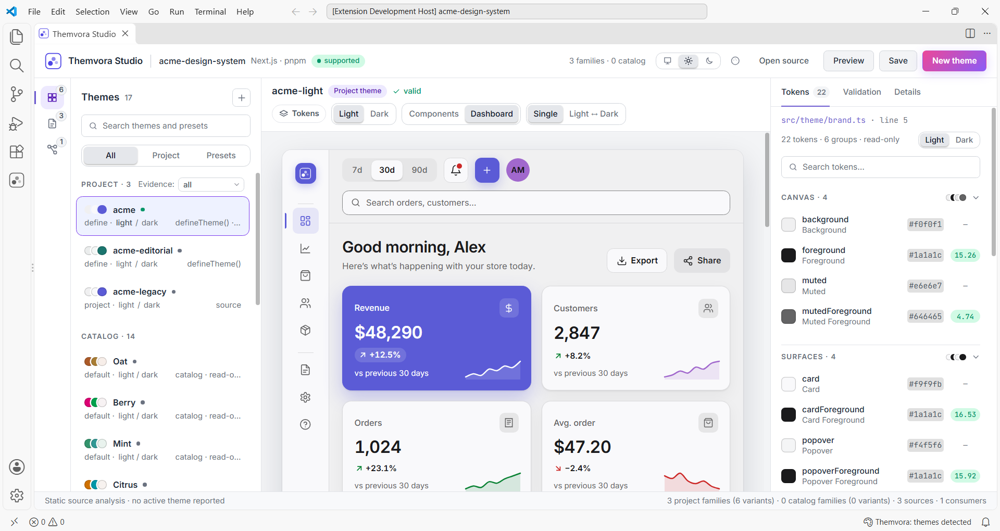

# Themvora

The theming runtime for modern applications. Semantic tokens, theme families,
SSR-safe hydration, smooth transitions, scoped themes, and ecosystem adapters —
for React, Next.js, Vue, Nuxt, Svelte, Solid, Angular, Astro, Remix, and web
components.

[Documentation](https://themvora-dev.vercel.app) ·
[Playground](https://themvora-dev.vercel.app/playground) ·
[npm](https://www.npmjs.com/org/themvora) ·
[GitHub](https://github.com/themvora/themvora)

## Install

```bash
# Core + React
npm install @themvora/core @themvora/react

# Core + Next.js
npm install @themvora/core @themvora/next

# CLI (developer tooling, install globally or as a devDependency)
npm install -g @themvora/cli
```

> Themvora packages have **no third-party runtime dependencies**, with one
> exception: `@themvora/angular` depends on `tslib`. Framework packages also
> depend on other `@themvora/*` packages (`@themvora/core`, and
> `@themvora/web` for the framework bindings). Frameworks themselves are peer
> dependencies. Install only what your application actually uses, and see each
> package's `package.json` (or its npm page) for the exact list.

## Quick Start

```tsx
// Next.js app router — app/layout.tsx
import { ThemeProvider } from "@themvora/next";

export default function RootLayout({ children }) {
  return (
    <ThemeProvider themes={themes} defaultTheme="mint-light" initialMode="system">
      {children}
    </ThemeProvider>
  );
}
```

```tsx
// Any client component
"use client";
import { useTheme } from "@themvora/next/client";

export function ThemeSwitcher() {
  const { theme, mode, setMode, toggleTheme } = useTheme();
  return (
    <div>
      <span>{theme.name} | {mode}</span>
      <button onClick={toggleTheme}>Toggle</button>
      <button onClick={() => setMode("light")}>Light</button>
      <button onClick={() => setMode("dark")}>Dark</button>
      <button onClick={() => setMode("system")}>System</button>
    </div>
  );
}
```

## Features

- **Theme families** — independent palette + mode switching (`mint-light`,
  `mint-dark`, `plum-light`, ...) from one `setFamily` / `setMode` API.
- **Semantic tokens** — recursive token groups, references, and expressions,
  mapped to CSS variables.
- **SSR-first zero flash** — fingerprint-guarded cookie persistence, server
  resolution, and a blocking bootstrap script in every framework.
- **ThemeScope** — isolate a subtree with its own theme, family, and local
  token definitions.
- **Transitions** — diff → plan → animate pipeline with reduced-motion support.
- **Scheduling** — sunrise/sunset theme switching (NOAA solar math) in every
  framework.
- **ThemeScrollbar** — a theme-colored overlay scrollbar with no layout shift.
- **9 adapters** — MUI, Chakra UI, Ant Design, Mantine, shadcn/ui, Bootstrap,
  DaisyUI, Open Props, UnoCSS.
- **CLI** — `themvora generate`, `list`, `validate`, `inspect`, `diff`,
  `explain`, `audit`, `doctor`, `init`, `add`, `migrate`, `export`,
  `completion`.

## Ecosystem

```
@themvora/core       Framework-agnostic runtime (store, adapters, utils)
@themvora/react      React hooks & provider
@themvora/next       Next.js App Router integration (SSR, cookies)
@themvora/vue        Vue 3 integration
@themvora/nuxt       Nuxt module (SSR, cookies, zero flash)
@themvora/svelte     Svelte 5 integration
@themvora/solid      SolidJS integration
@themvora/angular    Angular integration
@themvora/astro      Astro integration
@themvora/remix      Remix integration
@themvora/web        Web Components + vanilla
@themvora/tailwind   Tailwind CSS v4 plugin
@themvora/cli        Theme generator / validator / migrator
@themvora/*          MUI, Chakra, AntD, Mantine, shadcn, Bootstrap,
                      DaisyUI, Open Props, UnoCSS adapters
```

## Independent packages

Every Themvora package is independently installable:

- **Framework integrations don't pull in each other.** Installing
  `@themvora/next` brings Next + React support and nothing else — it does not
  install `@themvora/vue`, `@themvora/svelte`, or any adapter.
- **Adapters are opt-in.** The component-library adapters (`@themvora/mui`,
  `@themvora/chakra`, `@themvora/antd`, `@themvora/mantine`,
  `@themvora/shadcn`, `@themvora/bootstrap`, `@themvora/daisyui`,
  `@themvora/open-props`, `@themvora/unocss`) are separate packages, installed
  only when you explicitly want them. Their framework wrappers live behind
  subpaths (`/react`, `/vue`, `/svelte`, `/solid`, `/angular`) with optional
  peers, so `import { useShadcnTheme } from "@themvora/shadcn/react"` works
  without installing Vue or Angular.
- **Core has zero runtime dependencies.** `@themvora/core` ships no
  `dependencies` and no `peerDependencies`; framework packages declare their
  framework as a peer and are installed only when your app actually uses them.

## CLI

```bash
# Create a working, themed project — or integrate into an existing one
themvora init my-app --framework react
themvora init . --framework next --preset mint
themvora add brand apple

themvora list presets
themvora generate --seed "#6366f1" --family indigo
themvora generate --preset mint
themvora validate themes/my-theme.json
themvora inspect themes/my-theme.json
themvora diff mint iris
themvora explain --brand apple
themvora audit presets
themvora doctor
themvora export themes/my-theme.json --format css
```

`init` scaffolds with the framework's own generator (React, Next.js, Vue,
Svelte or Solid), wires the provider and the zero-flash bootstrap, and then
verifies the result by running the project's own build and typecheck. `add`
extends an integrated project's theme registry afterwards, and `completion`
emits a shell completion script.

Generate from a seed colour, a canonical preset, or a brand-inspired recipe;
then compare, explain, audit, inspect, and export. See the
[CLI documentation](https://themvora-dev.vercel.app/cli) for the full command
reference.

## Themvora for VS Code

The same theme tooling, inside the editor: a theme library, a live preview
canvas, a token inspector with contrast measurements, and a generator — for the
themes in **your application**, not your editor's colour theme.



- **Explore** project themes, catalog presets and drafts as cards with swatch
  strips, family, mode, origin, registration evidence and source file.
- **Preview** a dashboard or component gallery rendered from the selected
  tokens, with light/dark comparison when a family has both variants.
- **Inspect** every colour token's value, CSS custom property and measured
  contrast — failures name the token, the ratio, the floor and which side is
  wrong.
- **Create** a theme from a seed, a preset or an existing family, with live
  validation before anything is written, then save as JSON, TypeScript with
  `defineTheme()`, or CSS variables.
- **Validate** JSON theme documents, and get diagnostics, role hovers and colour
  swatches inline while editing them.

The extension reads your project's themes statically and never executes your
code, makes no network request, and collects no telemetry.

The extension is **not yet published to the Visual Studio Marketplace**, so
there is no listing to install from yet. Build and install the `.vsix`:

```bash
pnpm install
pnpm --filter themvora-vscode build

cd packages/vscode
pnpm package                      # -> themvora-vscode-0.1.0.vsix
code --install-extension themvora-vscode-0.1.0.vsix
```

[Extension documentation](https://themvora-dev.vercel.app/vscode) ·
[Package](packages/vscode) ·
[Architecture](packages/vscode/architecture.md) ·
[README](packages/vscode/README.md) ·
[Issues](https://github.com/themvora/themvora/issues)

## Documentation

Full documentation: <https://themvora-dev.vercel.app>

- [Frameworks](https://themvora-dev.vercel.app/framework-guides)
- [API Reference](https://themvora-dev.vercel.app/api-reference)
- [Playground](https://themvora-dev.vercel.app/playground)
- [Known Limitations](https://themvora-dev.vercel.app/known-limitations)

## Contributing & Documentation Workflow

All user-facing docs live in this repo and are generated/guarded by scripts —
hand-editing generated output will be reverted by the release gate.

- **API reference** (`apps/docs/content/api-reference/**.md`) is **generated**:
  edit `docs/reference/capabilities.ts` (canonical capability registry +
  descriptions) and run `npm run docs:generate-api`. Never edit the `.md`
  output by hand.
- **Capability/contract handbook**: `docs/reference/README.md` (manual
  reference for maintainers) and `docs/reference/capabilities.ts` (the
  machine-readable source of truth).
- **Guides** (`apps/docs/content/*.md`, framework/adapter pages via
  `apps/docs/lib/frameworks.tsx` / `libraries.tsx`) are hand-written; snippets
  must import real shipped symbols (enforced by the snippet audit).
- **Before pushing docs or API changes**, run the release gate:

```bash
npm run docs:release-gate
```

It chains the public-API classification check, export inventory, snippet
baseline, audits B/C/E/F, and the §2/§3 page-contract audit. Audit C's dynamic
half (`node scripts/docs/audits/audit-c-examples.mjs --dynamic`) compiles every
canonical example against packed tarballs — run it when touching examples or
package entrypoints (needs network for peer installs). The browser smoke audit
(`scripts/docs/audits/audit-browser-smoke.mjs`) is a manual pre-release check
requiring a production docs build.

## License

[MIT](https://github.com/themvora/themvora/blob/main/LICENSE)
