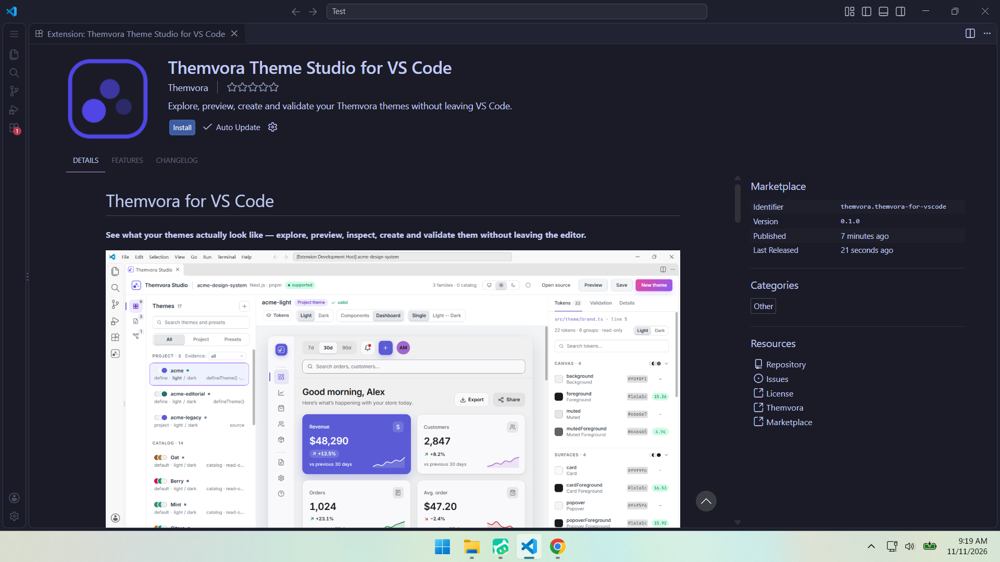

# Themvora

The theming runtime for modern applications. Semantic tokens, theme families,
SSR-safe hydration, smooth transitions, scoped themes, and ecosystem adapters —
for React, Next.js, Vue, Nuxt, Svelte, Solid, Angular, Astro, Remix, and web
components.

[Documentation](https://themvora-dev.vercel.app) ·
[Playground](https://themvora-dev.vercel.app/playground) ·
[npm](https://www.npmjs.com/org/themvora) ·
[GitHub](https://github.com/themvora/themvora)

## Install

```bash
# Core + React
npm install @themvora/core @themvora/react

# Core + Next.js
npm install @themvora/core @themvora/next

# CLI (developer tooling, install globally or as a devDependency)
npm install -g @themvora/cli
```

> Themvora packages have **no third-party runtime dependencies**, with one
> exception: `@themvora/angular` depends on `tslib`. Framework packages also
> depend on other `@themvora/*` packages (`@themvora/core`, and
> `@themvora/web` for the framework bindings). Frameworks themselves are peer
> dependencies. Install only what your application actually uses, and see each
> package's `package.json` (or its npm page) for the exact list.

## Set up

The example below uses Next.js. Vue, Nuxt, Svelte, Solid, Angular, Astro, Remix,
Web Components and Tailwind follow the same six steps — each package README
shows that framework's own snippets, and [Quick Start](https://themvora-dev.vercel.app/quick-start)
shows all of them side by side.

`ThemeProvider` in `@themvora/next` is a server component. It reads the theme cookies during the request and renders `<html data-theme>` — and `<body>` — itself, with the resolved variables already inline. Do not wrap it in `<html>` or `<body>`; the provider owns both elements, which is what makes the first byte correct.

```tsx title="app/layout.tsx"
import type { ReactNode } from "react";
import { Geist } from "next/font/google";
import { ThemeProvider } from "@themvora/next";
import "./globals.css";

const geist = Geist({
  subsets: ["latin"],
});

export default function RootLayout({
  children,
}: {
  children: ReactNode;
}) {
  return (
    // ThemeProvider renders <html> and <body> itself — do not wrap it in them.
    <ThemeProvider
      defaultTheme="light"
      body={{ className: geist.className }}
    >
      <main>
        {children}
      </main>
    </ThemeProvider>
  );
}
```

## Run and choose a theme

The toggle is a client component: `useTheme()` from `@themvora/next/client` reads the runtime the server provider installed. The markup carries only four classes — `page`, `primary`, `card` and `muted` — and no CSS.

```tsx title="app/theme-switcher.tsx"
"use client";
import { useTheme } from "@themvora/next/client";

export function ThemeSwitcher() {
  const { theme, mode, toggleTheme } = useTheme();

  return (
    <main className="page">
      <h1>Themvora</h1>
      <p>Current theme: {theme.name} ({mode})</p>

      <button className="primary" type="button" onClick={toggleTheme}>
        Toggle theme
      </button>

      <section className="card">
        <h2>Themed card</h2>
        <p className="muted">Surface, border and text follow the theme.</p>
      </section>
    </main>
  );
}
```

Those four classes are plain CSS. The next step puts the document rule and those classes in a global stylesheet; nothing is inlined or scoped here.

## Add the global stylesheet

Put the document rule and the four classes from step 3 in `app/globals.css`. Themvora emits its design tokens as CSS custom properties on the root element, so this stylesheet only reads them.

```css title="app/globals.css"
/* Themvora emits its design tokens as CSS custom properties on the root
   element, so a stylesheet only has to read them. Nothing here is
   theme-specific. */
html,
body {
  background: var(--theme-color-background);
  color: var(--theme-color-foreground);
}

.page {
  min-height: 100vh;
  padding: 2rem;
}

.primary {
  background: var(--theme-color-primary);
  color: var(--theme-color-primaryForeground);
  border: 0;
  border-radius: 0.5rem;
  padding: 0.5rem 1rem;
}

.card {
  background: var(--theme-color-card);
  border: 1px solid var(--theme-color-border);
  border-radius: 0.75rem;
  margin-top: 1.5rem;
  padding: 1rem;
}

.muted {
  color: var(--theme-color-mutedForeground);
}
```

Load it once from `app/layout.tsx` with `import "./globals.css";`, so the classes from step 3 pick up the theme.

## Add a small UI

A status card with a heading, a description, a status label and a primary button.

```tsx title="app/workspace-card.tsx"
export function WorkspaceCard() {
  return (
    <div className="themvora-example-card">
      <div className="themvora-example-header">
        <h3 className="themvora-example-title">Design system</h3>
        <span className="themvora-example-status">Active</span>
      </div>
      <p className="themvora-example-description">
        Tokens resolve at runtime, so this card follows whichever theme is active.
      </p>
      <p className="themvora-example-meta">Updated 2 minutes ago</p>
      <button className="themvora-example-button" type="button">View themes</button>
    </div>
  );
}
```

## Style it with Themvora tokens

Only the component rules live here — the document rule is in the global stylesheet from step 4, so it is not repeated below. Every colour is a required semantic token, so any theme that passes `validateTheme()` emits it; radius and shadow are optional and carry fallbacks, and no typography token is read.

```css title="app/globals.css"
.themvora-example-card {
  display: grid;
  gap: 10px;
  max-width: 22rem;
  padding: 16px;
  border: 1px solid var(--theme-color-border);
  border-radius: var(--theme-radius-lg, 12px);
  background: var(--theme-color-card);
  color: var(--theme-color-cardForeground);
  font-family: inherit;
  line-height: 1.5;
  box-shadow: var(--theme-shadow-sm, 0 1px 2px rgb(0 0 0 / 0.06));
}

.themvora-example-header {
  display: flex;
  align-items: center;
  justify-content: space-between;
  gap: 8px;
}

.themvora-example-title {
  margin: 0;
  font-size: 15px;
  font-weight: 600;
}

.themvora-example-status {
  display: inline-flex;
  align-items: center;
  gap: 6px;
  font-size: 12px;
  font-weight: 500;
  color: var(--theme-color-success);
}

.themvora-example-status::before {
  content: "";
  width: 6px;
  height: 6px;
  border-radius: 9999px;
  background: currentColor;
}

.themvora-example-description {
  margin: 0;
  font-size: 13px;
  color: var(--theme-color-mutedForeground);
}

.themvora-example-meta {
  margin: 0;
  font-size: 12px;
  color: var(--theme-color-mutedForeground);
}

.themvora-example-button {
  justify-self: start;
  padding: 8px 14px;
  border: 0;
  /* Presets and generated themes emit --theme-radius-lg and nothing else on
     the radius scale, so the smaller step is derived from it rather than
     assumed — the same proportion the utility-class mapping uses. */
  border-radius: calc(var(--theme-radius-lg, 12px) * 0.8);
  background: var(--theme-color-primary);
  color: var(--theme-color-primaryForeground);
  font: inherit;
  font-size: 13px;
  font-weight: 600;
  cursor: pointer;
}

.themvora-example-button:hover {
  filter: brightness(1.08);
}

.themvora-example-button:focus-visible {
  outline: 2px solid var(--theme-color-ring);
  outline-offset: 2px;
}
```

`.themvora-example-card` and its children read Themvora tokens, so switching the active theme repaints them — no re-render, and no per-theme CSS.

> The CLI is a separate developer tool: `npm install -g @themvora/cli`. Every other
> integration installs the same way — see its package README for the exact command.

## Features

- **Theme families** — independent palette + mode switching (`mint-light`,
  `mint-dark`, `plum-light`, ...) from one `setFamily` / `setMode` API.
- **Semantic tokens** — recursive token groups, references, and expressions,
  mapped to CSS variables.
- **SSR-first zero flash** — fingerprint-guarded cookie persistence, server
  resolution, and a blocking bootstrap script in every framework.
- **ThemeScope** — isolate a subtree with its own theme, family, and local
  token definitions.
- **Transitions** — diff → plan → animate pipeline with reduced-motion support.
- **Scheduling** — sunrise/sunset theme switching (NOAA solar math) in every
  framework.
- **ThemeScrollbar** — a theme-colored overlay scrollbar with no layout shift.
- **9 adapters** — MUI, Chakra UI, Ant Design, Mantine, shadcn/ui, Bootstrap,
  DaisyUI, Open Props, UnoCSS.
- **CLI** — `themvora generate`, `list`, `validate`, `inspect`, `diff`,
  `explain`, `audit`, `doctor`, `init`, `add`, `migrate`, `export`,
  `completion`.

## Ecosystem

```
@themvora/core       Framework-agnostic runtime (store, adapters, utils)
@themvora/react      React hooks & provider
@themvora/next       Next.js App Router integration (SSR, cookies)
@themvora/vue        Vue 3 integration
@themvora/nuxt       Nuxt module (SSR, cookies, zero flash)
@themvora/svelte     Svelte 5 integration
@themvora/solid      SolidJS integration
@themvora/angular    Angular integration
@themvora/astro      Astro integration
@themvora/remix      Remix integration
@themvora/web        Web Components + vanilla
@themvora/tailwind   Tailwind CSS v4 plugin
@themvora/cli        Theme generator / validator / migrator
@themvora/*          MUI, Chakra, AntD, Mantine, shadcn, Bootstrap,
                      DaisyUI, Open Props, UnoCSS adapters
```

## Independent packages

Every Themvora package is independently installable:

- **Framework integrations don't pull in each other.** Installing
  `@themvora/next` brings Next + React support and nothing else — it does not
  install `@themvora/vue`, `@themvora/svelte`, or any adapter.
- **Adapters are opt-in.** The component-library adapters (`@themvora/mui`,
  `@themvora/chakra`, `@themvora/antd`, `@themvora/mantine`,
  `@themvora/shadcn`, `@themvora/bootstrap`, `@themvora/daisyui`,
  `@themvora/open-props`, `@themvora/unocss`) are separate packages, installed
  only when you explicitly want them. Their framework wrappers live behind
  subpaths (`/react`, `/vue`, `/svelte`, `/solid`, `/angular`) with optional
  peers, so `import { useShadcnTheme } from "@themvora/shadcn/react"` works
  without installing Vue or Angular.
- **Core has zero runtime dependencies.** `@themvora/core` ships no
  `dependencies` and no `peerDependencies`; framework packages declare their
  framework as a peer and are installed only when your app actually uses them.

## CLI

```bash
# Create a working, themed project — or integrate into an existing one
themvora init my-app --framework react
themvora init . --framework next --preset mint
themvora add brand apple

themvora list presets
themvora generate --seed "#6366f1" --family indigo
themvora generate --preset mint
themvora validate themes/my-theme.json
themvora inspect themes/my-theme.json
themvora diff mint iris
themvora explain --brand apple
themvora audit presets
themvora doctor
themvora export themes/my-theme.json --format css
```

`init` scaffolds with the framework's own generator (React, Next.js, Vue,
Svelte or Solid), wires the provider and the zero-flash bootstrap, and then
verifies the result by running the project's own build and typecheck. `add`
extends an integrated project's theme registry afterwards, and `completion`
emits a shell completion script.

Generate from a seed colour, a canonical preset, or a brand-inspired recipe;
then compare, explain, audit, inspect, and export. See the
[CLI documentation](https://themvora-dev.vercel.app/cli) for the full command
reference.

## Themvora Theme Studio for VS Code

The same theme tooling, inside the editor: a theme library, a live preview
canvas, a token inspector with contrast measurements, and a generator — for the
themes in **your application**, not your editor's colour theme.

Published on the Visual Studio Marketplace as **Themvora Theme Studio for VS
Code**, by **Themvora**. The identifier is
`themvora.themvora-for-vscode` — that is the exact string to search for, install
or report an issue against.

[Open the Marketplace listing](https://marketplace.visualstudio.com/items?itemName=themvora.themvora-for-vscode) ·
[Extension documentation](https://themvora-dev.vercel.app/vscode) ·
[Package](packages/vscode) ·
[Architecture](packages/vscode/architecture.md) ·
[README](packages/vscode/README.md) ·
[Issues](https://github.com/themvora/themvora/issues)



[View the full-size screenshot](apps/docs/public/vscode/marketplace-listing.png)

### Install

1. Open the Extensions view with `Ctrl+Shift+X` (`Cmd+Shift+X` on macOS).
2. Search for **Themvora Theme Studio**. For one exact result, paste
   `@id:themvora.themvora-for-vscode` into the search box instead.
3. Open the result published by **Themvora** and choose **Install**.
4. Run **Developer: Reload Window**. A Themvora icon appears in the Activity Bar.

From a terminal:

```bash
code --install-extension themvora.themvora-for-vscode
```

On a machine with VS Code installed, a Markdown preview or a web page can also
open the listing directly in the editor with
`vscode:extension/themvora.themvora-for-vscode`; the documentation site has an
**Open in VS Code** button that does exactly that.

### What it does


- **Explore** project themes, catalog presets and drafts as cards with swatch
  strips, family, mode, origin, registration evidence and source file.
- **Preview** a dashboard or component gallery rendered from the selected
  tokens, with light/dark comparison when a family has both variants.
- **Inspect** every colour token's value, CSS custom property and measured
  contrast — failures name the token, the ratio, the floor and which side is
  wrong.
- **Create** a theme from a seed, a preset or an existing family, with live
  validation before anything is written, then save as JSON, TypeScript with
  `defineTheme()`, or CSS variables.
- **Validate** JSON theme documents, and get diagnostics, role hovers and colour
  swatches inline while editing them.

The extension reads your project's themes statically and never executes your
code, makes no network request, and collects no telemetry.

### Build from source

The published listing is the normal install path. To work on the extension
itself, build the `.vsix` from this repository and install it locally:

```bash
pnpm install
pnpm --filter themvora-for-vscode build

cd packages/vscode
pnpm package                      # -> themvora-for-vscode-0.1.1.vsix
code --install-extension themvora-for-vscode-0.1.1.vsix
```

## Documentation

Full documentation: <https://themvora-dev.vercel.app>

- [Frameworks](https://themvora-dev.vercel.app/framework-guides)
- [API Reference](https://themvora-dev.vercel.app/api-reference)
- [Playground](https://themvora-dev.vercel.app/playground)
- [Known Limitations](https://themvora-dev.vercel.app/known-limitations)

## Contributing & Documentation Workflow

All user-facing docs live in this repo and are generated/guarded by scripts —
hand-editing generated output will be reverted by the release gate.

- **API reference** (`apps/docs/content/api-reference/**.md`) is **generated**:
  edit `docs/reference/capabilities.ts` (canonical capability registry +
  descriptions) and run `npm run docs:generate-api`. Never edit the `.md`
  output by hand.
- **Capability/contract handbook**: `docs/reference/README.md` (manual
  reference for maintainers) and `docs/reference/capabilities.ts` (the
  machine-readable source of truth).
- **Guides** (`apps/docs/content/*.md`, framework/adapter pages via
  `apps/docs/lib/frameworks.tsx` / `libraries.tsx`) are hand-written; snippets
  must import real shipped symbols (enforced by the snippet audit).
- **Before pushing docs or API changes**, run the release gate:

```bash
npm run docs:release-gate
```

It chains the public-API classification check, export inventory, snippet
baseline, audits B/C/E/F, and the §2/§3 page-contract audit. Audit C's dynamic
half (`node scripts/docs/audits/audit-c-examples.mjs --dynamic`) compiles every
canonical example against packed tarballs — run it when touching examples or
package entrypoints (needs network for peer installs). The browser smoke audit
(`scripts/docs/audits/audit-browser-smoke.mjs`) is a manual pre-release check
requiring a production docs build.

## License

[MIT](https://github.com/themvora/themvora/blob/main/LICENSE)
