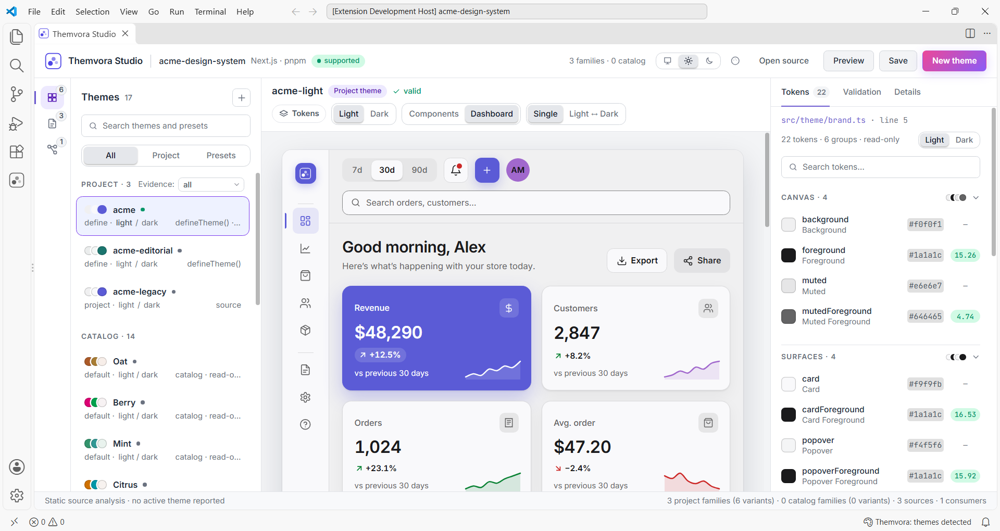
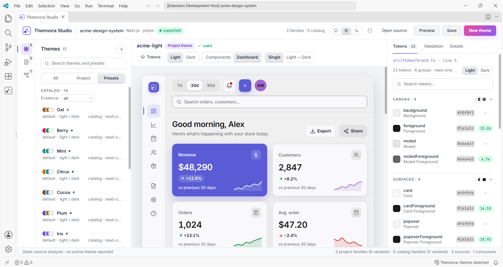
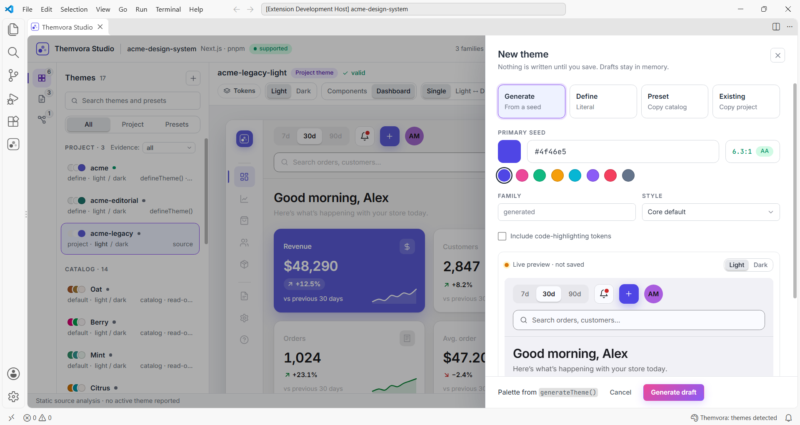
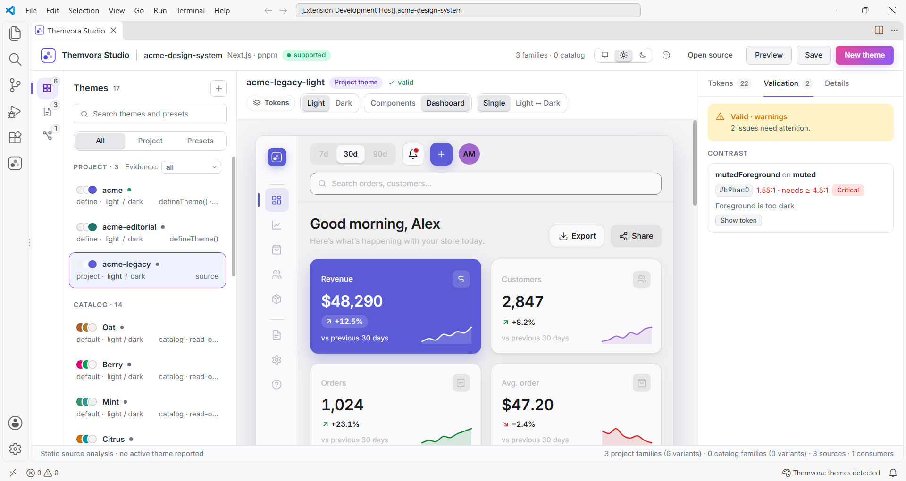
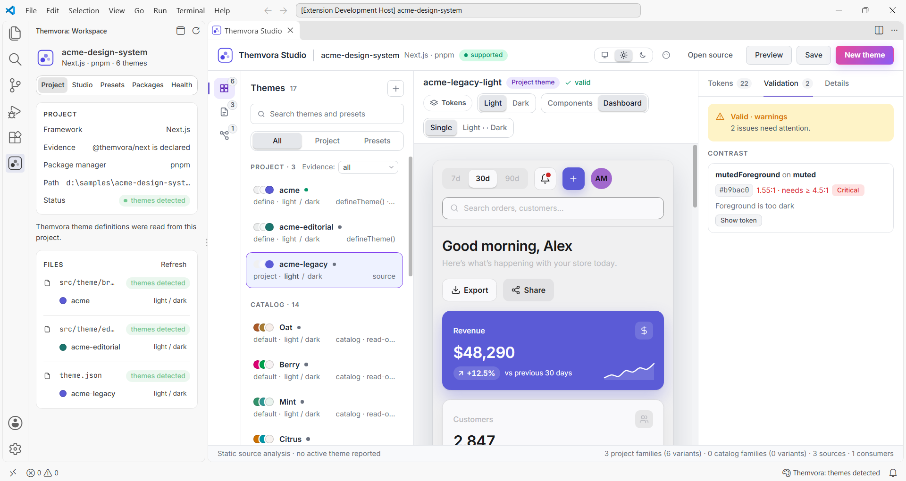

# Themvora for VS Code

**See what your themes actually look like — explore, preview, inspect, create and
validate them without leaving the editor.**

**Explore** · **Preview** · **Inspect** · **Create** · **Validate**

Themvora for VS Code brings the theme system into your editor. It reads the themes
already in your project, shows you what they resolve to, and writes new ones back
as a file you can commit.

It works on the themes in **your application** — not your editor's colour theme,
which it never changes.

---

## Explore your themes

See every theme Studio can find: the ones your project defines, the presets that
ship with Themvora, and any draft you are working on. Each card shows its palette,
its family, whether it is light or dark, where it came from, and which file it
lives in.

## Preview before you commit

The canvas renders a dashboard or a component gallery from the selected theme's
real tokens — navigation, cards, charts, tables, forms and status colours. Where a
family has both light and dark variants you can look at each one, and hovering a
token name outlines everywhere it is used, so you can see what a single change
would touch.

## Inspect design tokens

Every colour token shows its value, the CSS custom property it maps to, and its
measured contrast against the surfaces it sits on — so you do not have to work the
ratio out yourself or guess which pair is the problem.

## Create your own theme

Start from a seed colour, copy a preset, or branch off a theme your project already
has. The drawer previews every change as you make it, and **nothing is written to
disk until you choose to save**. Save as JSON, as TypeScript using
`defineTheme()`, or as CSS variables.

## Validate a theme

The validator names the token that fails, the ratio it measures, the floor it has
to reach, and which side is wrong — foreground too light, or background too dark.
That is usually enough to know what to change without opening a contrast
calculator. It checks the theme, not your application: a passing theme still has to
be used well.

## Compare themes

Comparing two themes shows what semantically differs between them, mode by mode,
rather than a wall of changed lines. It is the quickest way to answer “what would
actually change if we moved to this palette?” before switching a project over.

## Copy CSS variables

Select a theme, or one variant of a family, and copy its CSS custom properties.
Useful when the variables need to land somewhere that is not a Themvora project — a
stylesheet, a prototype, a design tool, a bug report.

## See what your project actually has

The workspace panel answers the questions a file tree cannot: is this a Themvora
project, which framework is it, which packages are declared, and are they installed.
Declared and installed are listed separately, because a package in `package.json`
that is missing from `node_modules` is exactly the state that breaks an app. Studio
also shows where each theme is defined and which files receive it, and can open that
exact line.

---

## Commands

Open the Command Palette with `Ctrl+Shift+P` (`Cmd+Shift+P` on macOS) and type
“Themvora”. Everything sits under the **Themvora** category.

- **Themvora: Open Theme Studio** — opens the theme library, preview canvas and
  inspector in one panel.
- **Themvora: Browse Presets** — lists the built-in preset catalog with the recipe
  behind each preset. Works in any folder.
- **Themvora: Preview Theme** — opens or updates the preview panel for the theme
  file you are editing.
- **Themvora: Generate Theme…** — asks for a seed colour, generates a light and
  dark pair, and opens it as an unsaved draft.
- **Themvora: Validate Theme…** — checks a theme file and reports what fails, on
  which token, and by how much.
- **Themvora: Compare Themes…** — shows what actually differs between two themes,
  mode by mode.
- **Themvora: Copy CSS Variables** — validates a theme, turns it into CSS custom
  properties and copies them.
- **Themvora: Refresh Project** — re-reads every workspace folder, for changes that
  produce no event at all — a `git checkout`, a generator run in a terminal.

While you edit a theme file, Studio also adds diagnostics on failing tokens, hovers
explaining what each semantic role is for, and colour swatches next to values.

## Requirements

- **VS Code 1.94.0 or newer.**
- **No global CLI install.** Everything the extension needs ships inside it, so it
  works in a project that has never run the Themvora CLI.
- **No project required to browse presets.** The catalog is built in.

## Good to know

- **Unsaved drafts live in memory.** A draft you have not saved survives closing
  the Studio, but not restarting VS Code.
- **Project analysis follows saved files.** Saving a theme, provider or config
  file re-reads the workspace, so the theme library and source relationships
  describe what is on disk. Typing does not: an unsaved edit changes the buffer,
  the Preview and the Problems panel, and the workspace catches up when you save.
  Files that appear, disappear or move are picked up immediately.
- **Studio works on one folder.** In a multi-root workspace the workspace panel
  lists every folder, but Studio reads the first one.
- **Source analysis is not runtime state.** Studio can prove that a component
  receives a theme. Which theme an app actually selects at runtime depends on
  storage, media queries and user choice, so Studio never claims a theme is active.
- **Themes that compute their values are not read.** Themes written as plain
  definitions are read; one assembled from function calls or computed values is
  listed with the reason it could not be read, rather than guessed at.
- **Some CLI commands are not in the editor.** `init`, `add`, `doctor` and `export`
  remain terminal commands.

## Privacy

Your code stays yours. The extension reads theme files and nothing else: it does
not run your project's code, does not change your editor theme, sends no telemetry,
and makes no network request. Nothing is written on activation, and applying a patch
to your provider is shown as a diff first.

## Learn more

- **Documentation:** [themvora-dev.vercel.app/vscode](https://themvora-dev.vercel.app/vscode)
- **Repository:** [github.com/themvora/themvora](https://github.com/themvora/themvora)
- **Architecture, for contributors:** [packages/vscode/architecture.md](https://github.com/themvora/themvora/blob/main/packages/vscode/architecture.md)
- **Issues:** [github.com/themvora/themvora/issues](https://github.com/themvora/themvora/issues)
- **Changelog:** [CHANGELOG.md](https://github.com/themvora/themvora/blob/main/packages/vscode/CHANGELOG.md)

## License

MIT — see [LICENSE](https://github.com/themvora/themvora/blob/main/packages/vscode/LICENSE).
