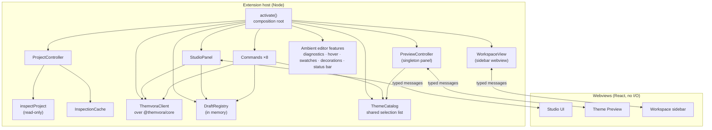

# Themvora for VS Code — architecture

The canonical architecture reference for `packages/vscode`. It describes the
extension as implemented today. Historical milestone and phase reports are
archived under [`docs/history/`](./docs/history/) and are **not** a description
of current behaviour; where the two disagree, this document and the code win.

- Package: `themvora-for-vscode` (private, not published to npm)
- Extension identifier: `themvora.themvora-for-vscode`
- Version: `0.1.1`
- Minimum engine: VS Code `^1.94.0`
- Entry point: `dist/index.js` (ESM)

---

## 1. Purpose and package boundaries

The extension puts Themvora's theme tooling inside the editor: it shows what a
project registers, previews and inspects a theme's tokens, generates and edits
theme drafts, and writes the result back as a file the CLI and the build
integrations can read.

Three boundaries define the package.

**Core owns theme semantics.** Generation, validation, contrast measurement,
preset catalogues, migration, diffing and CSS variable projection all come from
`@themvora/core`. This package formats and displays those results; it does not
compute them, and it does not carry a second palette solver.

**This package owns editor integration only.** Commands, views, panels, prompts,
diagnostics, hovers, decorations and the Studio webview. There is no theme engine
here and no CLI re-implementation.

**It is not an npm library.** `packages/vscode` is `private: true`. It is
distributed as a `.vsix`, not as `@themvora/vscode`. The package is consumed by
users through VS Code and by other extensions through the `ThemvoraApi` object
returned from `activate()`.

What it deliberately does not do:

| Not done | Why |
| --- | --- |
| Execute project code | Reading a theme must not have side effects. See §5. |
| Change `workbench.colorTheme` | The Studio previews a theme; it never claims to apply one. |
| Shell out to `@themvora/cli` | The CLI's modules require `node:fs` and process spawning. See §6. |
| Write on activation | Activation is a scan; every write is a user action. |
| Send telemetry or make network calls | Verified against the bundle; see §5. |

---

## 2. Runtime architecture



### 2.1 Activation and composition root

`src/extension.ts` is the composition root and nothing else. It builds the
services, registers the surfaces, and returns the public API. It performs no
writes, spawns no process and makes no network call.

Activation is triggered by `onLanguage:json`, `onLanguage:jsonc` and
`onView:themvora.workspace`. The first inspection is started but **not awaited**
(`void controller.refresh()`), so activation returns promptly and the sidebar
renders when the scan lands.

Every disposable is owned by `context.subscriptions`; `deactivate()` is empty by
design.

The public API is deliberately small:

```ts
interface ThemvoraApi {
  readonly version: string;
  readonly client: ThemvoraClient;      // canonical client over @themvora/core
  readonly projects: readonly RootView[]; // live, not a snapshot
  readonly studio: { isOpen(): boolean };
}
```

### 2.2 Shared services

| Service | File | Responsibility |
| --- | --- | --- |
| `ProjectController` | `services/projectController.ts` | Owns `roots`, coalesces refresh requests into one analysis at a time, invalidates the inspection cache per event, watches saves and the filesystem, publishes changes to both webviews. |
| `ThemvoraClient` | `services/coreClient.ts` | The only path to `@themvora/core`. Six operations — `generate`, `validate`, `catalog`, `diff`, `exportVariables`, `migrate` — each returning the same outcome envelope. |
| `DraftRegistry` | `services/draftRegistry.ts` | The single host-side owner of unsaved drafts. Stable id, monotonic revision, stale-revision refusal. |
| `ThemeCatalog` | `services/themeCatalog.ts` | The one selectable list every command reads: project themes, drafts and the active editor's document. |
| `PreviewController` | `commands/previewTheme.ts` | One preview panel per window; a second invocation updates rather than replaces it. |
| `StudioPanel` | `adapters/studioPanel.ts` | Hosts the Studio webview, owns selection, drafts, saving and navigation. |
| `RootSessions` | `services/rootSessions.ts` | Per-root write coordination, so two saves cannot interleave. |

### 2.3 Major data flows

**Inspection.** `ProjectController.refresh()` → `inspectProject(root)` reads the
manifest, the known theme files and the consumer graph → `RootView` per folder →
`onChange` → both webviews re-render. An inspection runs on activation, on an
explicit refresh, when the workspace folders change, and when a **saved** file
the last analysis depended on changes. Typing does not schedule one.

**Freshness.** Four things are called "the current theme" and they are kept
apart on purpose:

| State | Where it lives | What it reflects |
| --- | --- | --- |
| The editor buffer | `workspace.textDocuments` | What is on screen, saved or not. |
| The saved file | disk | What a save last wrote. |
| The workspace graph | `controller.roots` | The last analysis **of saved bytes**. |
| A Studio draft | `DraftRegistry` | In-memory work that never touched disk. |

Project-wide discovery reads the saved file, never the buffer — the
`ProjectReader` has no way to reach a document. Commands that promise to act on
what you are looking at read the buffer directly (`ThemeCatalog.activeDocument`,
`PreviewController.readText`), and the Preview labels a dirty source
`… • unsaved` rather than implying the graph has seen it.

**Selection.** Every surface reads the same list. A theme is addressed either by
`{ path, name }` (a project theme), by preset id (a catalog entry) or by draft id
(a registry record). Only the id travels for a draft: the host reads the record,
so revision and theme data are the registry's, not the webview's memory of them.

**Generation.** A seed is posted as an intent → `client.generate()` →
`generateTheme()` → the pair is registered in `DraftRegistry` **before** it is
shown → the Studio selects the new draft. Generation ends in a preview, never a
file; saving is a separate user action.

**Saving.** One write path serves the command, the sidebar and the Studio:
`saveToProject()` → `saveThemes()` → `RootSessions` → `workspace.fs.writeFile` →
`onWritten` → `controller.refresh()`.

### 2.4 Theme catalog

`ThemeCatalog` composes three sources at call time, not at construction:

- **Project themes** — from `controller.roots`, re-read on each call.
- **Drafts** — from `DraftRegistry.list()`, so a draft created a moment ago is
  selectable.
- **The active document** — parsed once at call time, because the buffer may
  hold a theme the inspection has not reached (an unsaved file, a path outside
  the scanned layout).

`roots` is a getter rather than a snapshot so a refresh is visible without
rebuilding the object.

### 2.5 Host-owned draft registry and draft lifecycle

A draft is created by the Studio, by `Generate Theme…`, or by copying a preset or
a project theme. It carries:

- `id` — stable for the life of the draft
- `revision` — monotonic; every mutation increments it
- `origin` — `generated` | `defined` | `preset` | `project`
- `scope` — `{ kind: "root", root }` or `{ kind: "standalone" }`
- `inputs` and `basis` — what it was generated from, or copied from

Lifecycle:

```
create ──► update* ──► markSaved ──► (still addressable)
   │           │
   │           └──► revert(expectedRevision) ──► update*
   └──► discard
```

Rules enforced in the registry, not in the UI:

- **A stale revision is refused, never applied.** `update`, `revert` and
  `markSaved` all take the caller's expected revision and return
  `{ kind: "stale-revision" }` on a mismatch. This is what stops a slow reply
  from overwriting a newer edit.
- **Drafts are in memory.** They survive a webview closing, because the panel is
  a view and the draft is not. They do **not** survive an extension-host restart.
- **Removing a folder detaches, it does not delete.** `detachRoot()` keeps the
  work addressable; discarding stays an explicit act.
- **`standalone` is not the first folder.** A draft generated from a seed with no
  project involved is not assigned to whichever folder happens to be open.

The Studio is the only writer; every other surface reads by id.

---

## 3. Host / webview boundary

### 3.1 Typed message protocol

`src/shared/studioProtocol.ts` is imported by both sides. It is DOM-free and
`vscode`-free, which is what lets the webview typecheck it without Node types.

- **Host → webview** (`StudioHostMessage`): `state`, `fileText`, `saveLocation`,
  `saveResult`, `patchPreview`, `draftPreview`.
- **Webview → host** (`StudioIntent`): `ready`, `selectProject`, `selectDraft`,
  `generate`, `previewGenerate`, `draftFromPreset`, `draftFromPresetId`,
  `draftFromTheme`, `presets`, `selectPreset`, `setMode`, `preview`, `open`,
  `copy`, `save`, `chooseSaveLocation`, `serialize`, `editToken`, `resetToken`,
  `resetGroup`, `resetDraft`, `discardDraft`, `generatePatch`, `applyPatch`,
  `openSource`, `openColorThemePicker`, `setStudioAppearance`.

`parseStudioIntent()` accepts only the known shapes. Unknown types and malformed
payloads are **dropped**, never forwarded to a handler as `unknown`.

`draftPreview` carries a `requestId`; the webview discards a reply whose id is not
the newest request, so a late preview cannot repopulate a closed drawer.

### 3.2 Responsibility split

| Concern | Host | Webview |
| --- | --- | --- |
| Reading files, workspace data | ✅ | ✖ — no filesystem authority |
| Theme semantics (generate/validate/contrast) | ✅ via core | ✖ |
| Selection, drafts, catalog | ✅ | ✖ — posts intents only |
| Saving, patch application | ✅ | ✖ |
| Layout, local UI state (filters, open panels) | ✖ | ✅ |
| Rendering tokens, preview pixels | ✖ | ✅ |

The webview has **no filesystem or network authority**. Every privileged
operation remains in the host. The sidebar view is presentation only: it receives
a model and posts intents.

### 3.3 State ownership and revision guards

The host is the single source of truth for anything that can be wrong: the
selected theme, its tokens, its validation verdict and the draft it came from.
The webview holds only UI state (which inspector tab, which filter, whether the
drawer is open) and mirrors the host's `state` message.

Three guards prevent stale data from being shown as current:

1. **Draft revisions** — a mutation carrying an old revision is refused (§2.5).
2. **Preview request ids** — a superseded generation preview is discarded.
3. **Selection identity** — `StudioApp` resets highlight, format and comparison
   state whenever `name`/`source`/`mode`/`origin`/`draftKind` change, so nothing
   is previewed from a previous selection.

### 3.4 Files, workspace data and editor operations

All reads go through `workspaceReader.ts`, which is read-only and rooted at a
folder URI. Opening a file at a position (`open`) validates the path first: no
absolute paths, no traversal, and only files the inspection actually produced.
Writes go through `saveThemes()`, which coordinates per root through
`RootSessions`.

---

## 4. Theme discovery and evidence

### 4.1 What is read

| Source | Handling |
| --- | --- |
| `theme.json`, `*.theme.json`, `themes/*.json` | Parsed and validated with core's `validateTheme()`. |
| `theme.config.*` | **Found and reported as unreadable.** Not evaluated. |
| `themes.ts` / `themes.js` / `.mjs` / `.cjs` | Located; parsed with core's `loadThemeRegistry()` literal reader. |
| Hand-written `defineTheme({ … })` literals in any `.ts`/`.js` whose path contains `theme` | Read as literals. |
| `.vue`, `.svelte`, `.astro`, `.html` | Script regions only, masked to preserve line/column positions. |

Files are found **by name, not by location**: `theme.config.*` and `themes.ts` are
discovered anywhere in the workspace, so `src/theme/brand.ts` is read the same as
a root-level file. The scan is bounded (see §7.4).

### 4.2 The four evidence levels

These are deliberately distinct, because collapsing them would let the UI assert
something it has not proven.

| Level | Meaning |
| --- | --- |
| **Definition** | A theme object exists and was read from source. |
| **Registration evidence** | A consumer statically receives the theme (`<ThemeProvider themes={[…]} />`, `config={{ themes }}`, a Web Components `themes` list). |
| **Runtime consumer evidence** | The consumer use was traced through the import graph to the definition, so the association is proven rather than assumed. |
| **Active runtime state** | Which theme is *currently applied* at runtime. |

`ThemeEvidence` values are `verified` (a traced consumer supplies it),
`registration-only` (a consumer relationship exists but the collection or
consumer is incomplete), `catalog` (it came from a canonical catalog call —
consumer use is a separate fact) and `defined-only` (no verified consumer
association was established).

### 4.3 Why source inspection is not proof of activation

Static analysis can prove that a consumer *receives* a theme. It cannot prove
which theme a running application selected, because selection happens at
runtime — from storage, a media query, a server decision or a user toggle. The
extension therefore never reports an active theme. The Studio footer states it
directly: *"Static source analysis · no active theme reported"*, and a draft
reads *"Generated in memory · nothing has been written yet"*.

This is the single most important honesty constraint in the package. Any new
surface must preserve it.

---

## 5. Security and trust boundaries

### 5.1 Workspace-file handling

- Reads are rooted at the folder URI and go through `workspaceReader.ts`.
- Paths arriving from a webview are validated before use: no absolute paths, no
  traversal, only files the inspection produced.
- The walk skips dependency and build directories and dot-directories, with a
  depth and file-count cap.

### 5.2 No execution of workspace code

The extension never evaluates project code. It does not import the project's
modules, does not run its build tool, and does not evaluate `theme.config.*`.
Readers parse **literals only**: a spread, a call, an identifier that cannot be
traced, or a template interpolation is reported with a reason rather than
guessed at. JSON5-style unquoted keys and single-quoted strings are not
supported; comments and trailing commas are, because core masks them without
replacing `JSON.parse`.

### 5.3 Network and external services

None. Verified rather than assumed:

- `src/` contains no `fetch`, no HTTP client, no socket and no `node:` import.
- The built `dist/index.js` imports exactly two modules: `vscode` and `crypto`
  (SHA-256 for cache keys in `cachingReader.ts` and `sourceAnalysisCache.ts`).
- `test/bundle.test.ts` reads the **build output** and asserts that the bundle's
  external imports are limited to `vscode` and an allow-list of Node built-ins.

The only outbound navigation is `env.openExternal()` on documentation links the
user explicitly chooses in a prompt.

### 5.4 Safe handoff and file-editing guarantees

- **Nothing is written on activation.** Inspection uses a read-only interface.
- **A written file is not a registered theme.** The save result says so; adding
  the file to a provider remains a manual step.
- **"Preview file" shows the exact bytes** before anything is written.
- **Patch application is a preview first.** `generatePatch` proposes a diff, the
  webview renders it in `PatchPreviewDialog`, and `applyPatch` runs only on
  explicit confirmation. `applyPatchSafety.test.ts` covers the refusal paths.
- **Saving never deletes.** A save writes the named file; nothing else in the
  workspace is touched.

---

## 6. Commands and workflows

Eight contributed commands. Identifiers and labels are the manifest's; behaviour
is the implementation's. User-facing descriptions live in the
[README](./README.md#commands).

| Command | Read-only | What it does |
| --- | --- | --- |
| `themvora.generateTheme` — Generate Theme… | ✖ writes | Prompts for a seed, calls the canonical generator, registers the pair as a draft, opens the save dialog. |
| `themvora.validateTheme` — Validate Theme… | ✅ | Validates every theme in one JSON document and reports. Failures are a warning with a report, not an error. |
| `themvora.copyCssVariables` — Copy CSS Variables | ✅ (clipboard) | Resolves a theme, validates it, projects it to CSS variables and copies once. Four outcomes kept distinct: unreadable, not a theme, invalid, copied. |
| `themvora.browsePresets` — Browse Presets | ✅ | Lists the canonical catalog with the recipe each preset came from. Browsing is not adding. |
| `themvora.compareThemes` — Compare Themes… | ✅ | Semantic, mode-by-mode diff through core's `diffThemes()`. A `{ light, dark }` pair stays a pair. |
| `themvora.previewTheme` — Preview Theme | ✅ | Opens or updates the singleton preview panel. |
| `themvora.refresh` — Refresh Project | ✅ | Re-reads every folder. Exists because a file can change without a save event. |
| `themvora.openStudio` — Open Theme Studio | ✖ writes | Opens the Studio. Refuses, with an explanation and two setup links, when no folder uses Themvora. |

`themvora.openStudio` and `themvora.refresh` also appear in the view title bar;
`themvora.previewTheme` appears in the editor title for theme files.

**CLI-backed operations are not built** — `init`, `add`, `doctor`,
`list frameworks`, `export --format css`. The CLI cannot be loaded in the
extension: its modules require `node:fs` and process spawning, which the bundle
gate forbids. The evidence and the proposed public API are in
[`docs/history/MILESTONE-3-CLI-DECISION.md`](./docs/history/MILESTONE-3-CLI-DECISION.md).

---

## 7. Development and verification

Run from the repository root.

```bash
pnpm install
pnpm --filter themvora-for-vscode build        # tsup bundle + tsc declarations + webview
pnpm --filter themvora-for-vscode typecheck    # src and webview
pnpm --filter themvora-for-vscode test         # vitest
pnpm --filter themvora-for-vscode test:host    # real VS Code, dev path
pnpm --filter themvora-for-vscode test:host:vsix  # real VS Code, packaged archive
```

Packaging:

```bash
pnpm --filter themvora-for-vscode build
cd packages/vscode && pnpm package   # -> themvora-for-vscode-0.1.1.vsix
node scripts/verify-vsix.mjs         # self-containment check
```

### 7.1 Layers

```text
src/domain/     pure: registry model, file names, inspection rules, wording,
                the outcome envelope, capability detection. No `vscode`, no I/O
                beyond the ProjectReader interface.
src/services/   the editor side: workspace.fs adapter, project controller,
                core-backed client, per-root write coordination, caches.
src/adapters/   webview hosts, tree view, status bar, decorations, diagnostics.
src/commands/   command handlers.
webview/        the Studio UI (React). Posts typed intents; owns no authority.
src/extension.ts  composition root.
```

### 7.2 Architectural regression tests

These are the tests that fail when the architecture erodes, rather than when a
feature breaks:

| Test | Asserts |
| --- | --- |
| `bundle.test.ts` | The built bundle's external imports are `vscode` + allowed Node built-ins. |
| `manifest.test.ts` | Every contributed command has a handler; identifiers match. |
| `publicApi.test.ts` | `activate()` returns the documented API shape. |
| `draftRegistry.test.ts`, `draftStaleResults.test.ts` | Revision semantics and stale-revision refusal. |
| `studioProtocol.test.ts` | Only known intents parse; malformed payloads are dropped. |
| `applyPatchSafety.test.ts` | Patch application refuses unverified or unsafe proposals. |
| `registryPaths.test.ts` | The duplicated registry paths still match the CLI's. |
| `workspaceReader.test.ts` | Reads stay inside the root; no traversal. |
| `savedAnalysis.test.ts` | Typing costs no analysis; saves, creates, deletes and renames do; duplicate notifications coalesce; `await refresh()` publishes before it resolves. |
| `test/host/smoke.cjs` | The ESM entry loads, `activate()` runs, a command executes end to end. |

### 7.3 Making a change

1. Change `src/` or `webview/`.
2. `pnpm --filter themvora-for-vscode typecheck` — the webview has its own tsconfig,
   so a host-only typecheck misses it.
3. `pnpm --filter themvora-for-vscode test`.
4. `pnpm --filter themvora-for-vscode build`, then `test:host`. The host test is the
   only check that proves the ESM entry point loads and `activate()` runs.
5. If packaging changed, `test:host:vsix`. A `.vsix` that omits a file fails
   here rather than after publishing.

Do not bypass these gates by editing `dist/` or the manifest's `main`. The host
test loads the source tree, and the vsix test loads the archive, so both see the
real artefact.

### 7.4 Resource bounds

`src/domain/resourceBounds.ts` caps the work a single inspection can do, so a
large workspace degrades instead of hanging:

| Bound | Default |
| --- | --- |
| Files enumerated | 2000 |
| Files parsed | 1000 |
| Themes discovered | 500 |
| Import edges resolved | 5000 |
| Consumers analysed | 200 |
| Cache entries | 10 000 |
| Concurrent reads | 10 |

Refreshes are coalesced and cancellable. Requests that arrive while one is
waiting merge into it, so a burst of saves is one analysis; a request that
arrives while one is running cancels it and becomes the next run, so two scans
never overlap and a superseded result is never published. `await refresh()`
resolves after the new roots are published, not before.

---

## 8. Invariants and limitations

### 8.1 Invariants

These are contracts. Changing one is an architectural change, not a refactor.

1. **Core owns theme semantics.** No palette maths, contrast solver or token
   vocabulary is re-implemented here.
2. **The host is the only authority.** Webviews post intents and hold no
   filesystem, network or theme-semantics capability.
3. **A draft has a stable id and a monotonic revision.** A mutation with a stale
   revision is refused, never applied.
4. **Saving, reverting and discarding are three distinct acts.** Revert returns a
   draft to its baseline; discard removes it from the registry; saving writes a
   file. None of them implies another.
5. **Source evidence is not runtime state.** No surface claims a theme is active.
6. **Activation writes nothing** and makes no network call.
7. **The bundle imports only `vscode` and Node built-ins**, asserted against the
   build output.

### 8.2 Verified limitations

| Limitation | Reason |
| --- | --- |
| **Drafts are in memory.** They survive a webview closing, not a host restart. | Drafts are not project files; persisting them would create a second source of truth for a theme nobody has saved. |
| **The Studio binds to the first workspace folder.** In a multi-root workspace, opening is permitted when *any* folder uses Themvora, but the library, drafts and saves read `roots[0]`. | Not yet designed for per-root Studio state. |
| **A theme that computes its values is not read.** Literal `defineTheme({ … })` is read; a spread, call, identifier or interpolation is refused with a reason. | The readers parse literals and never evaluate project code. |
| **`theme.config.*` is not evaluated.** It is found and reported as unreadable. | Reading it means executing workspace TypeScript through the project's build tool. |
| **Template expressions are read, not evaluated.** Literal arrays, traced identifiers and `config={{ themes }}` are read; computed values and conditionals are `dynamic-unverified`. | Same literal-only boundary. |
| **Inline Web Components theme objects are refused.** The `themes` name list is supported; a JSON array of full definitions is reported as dynamic. | Interpreting definitions from an attribute would create a second theme model. |
| **The Define workflow starts from a generated baseline.** | The Studio inspects and edits tokens; it is not a blank-sheet token designer. |
| **JSON5-style syntax is not supported.** | `JSON.parse` is still the parser; core masks comments and commas. |
| **No diagnostics inside `themes.ts`.** Its themes are read and shown, but diagnostics, hovers and swatches work on JSON theme documents. | Those features map token paths to positions in a JSON document; a TypeScript module needs a different mapping. |
| **No CLI-backed operations.** | Blocked on a CLI API change; see §6. |

### 8.3 Deferred, not implemented

Deferred work is listed separately so it is never mistaken for behaviour:

- CLI transport for the client (`init`, `add`, `doctor`, `export --format css`).
  The outcome envelope already carries a `cli` capability slot that reports
  `available: false` with a reason.
- Diagnostics and hovers for registry modules.
- Per-root Studio state in multi-root workspaces.
- A status-bar or tree glyph from a custom icon font (`contributes.icons` needs
  a designed `.woff`; the package ships SVG and uses codicons in text).

---

## Related documents

- [`README.md`](./README.md) — user-facing product documentation and installation.
- [`CHANGELOG.md`](./CHANGELOG.md) — release history.
- [`docs/history/`](./docs/history/) — archived milestone, increment and phase
  reports. Historical record; not a description of current behaviour.
- [`docs/verification/editor-ux-checklist.md`](./docs/verification/editor-ux-checklist.md)
  — the manual editor-integration checklist.
